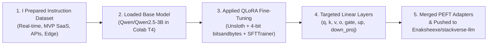
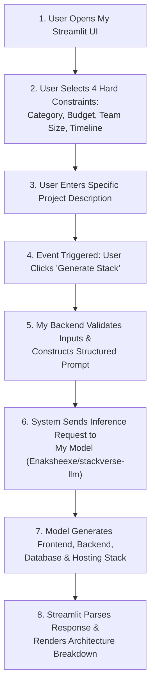

# StackVerse: AI-Powered Tech Stack Recommender
**Demo/Example working model**


**Live Demo:** [https://stackverse.streamlit.app/](https://stackverse.streamlit.app/)  
**My Fine-Tuned Model:** [`Enaksheexe/stackverse-llm`](https://huggingface.co/Enaksheexe/stackverse-llm)  
**Google Colab Training Notebook:** [](https://colab.research.google.com/drive/1ZG8qniX9LqgMO1hTtS3OCrNUMgiCK7eC)

I built StackVerse to help developers choose the right frontend, backend, database, and deployment tools based on their specific project requirements, constraints, and scalability targets. 

Instead of just building a generic prompt wrapper around a proprietary API, I created this application on top of my own custom fine-tuned `Qwen 2.5 3B` model (`Enaksheexe/stackverse-llm`), which I trained specifically to evaluate software architecture trade-offs and recommend practical tech stacks.

## My Motivation & Why I Built This

Whenever I start a new project, I noticed that choosing a tech stack often defaults to whatever is currently trending rather than what actually fits the system architecture. Furthermore, when I asked general-purpose LLMs for stack recommendations, they gave me overly verbose, non-committal "it depends" answers. 

I decided to solve this problem myself by fine-tuning a lightweight 3B parameter model. My goal was to train it to output structured, practical architecture recommendations that balance development speed, ecosystem maturity, and infrastructure overhead based on real-world constraints.

## System Architecture & Flow of Work

Before building the application, I designed the system flow in two parts: how I trained and deployed the model, and how the live application handles user events from input to output.

### 1. My Model Training & Deployment Flow


### 2. Application Event & System Workflow


### Step-by-Step Breakdown of How My System Works:
1. **Constraint Collection (Frontend):** In the Streamlit interface I built, the user first sets four strict parameters: Project Category, Budget, Team Size, and Timeline, followed by a custom text description of what they want to build.
2. **Input Validation & Prompt Formatting (Backend):** When the user clicks the **Generate Stack** button, my backend script validates that the required inputs are present and injects those parameters into the exact structured instruction template I used during training.
3. **Model Inference:** My backend sends the formatted prompt to my fine-tuned `Enaksheexe/stackverse-llm` model hosted on Hugging Face.
4. **Response Parsing & UI Rendering:** The model returns a tailored recommendation covering the Frontend, Backend, Database, and Deployment tools along with architectural trade-offs, which my Streamlit app parses and displays cleanly on the screen.

## How I Fine-Tuned the Model

I fine-tuned the base `Qwen/Qwen2.5-3B` model to create [`Enaksheexe/stackverse-llm`](https://huggingface.co/Enaksheexe/stackverse-llm) using the following workflow:

* **My Training Environment:** I ran the training pipeline on a Google Colab T4 GPU instance.
* **Optimization Framework:** I used [Unsloth](https://github.com/unslothai/unsloth), which gave me 2x faster training speeds and reduced my VRAM usage by ~60% so the model could train smoothly on a single T4 GPU.
* **My Fine-Tuning Method:** I implemented QLoRA (4-bit quantization via `bitsandbytes`) with PEFT adapters targeting all linear layers (`q_proj`, `k_proj`, `v_proj`, `o_proj`, `gate_proj`, `up_proj`, `down_proj`).
* **Training Loop:** I used Hugging Face `TRL` (`SFTTrainer`) formatted with structured instruction-response pairs that I curated to cover diverse software requirements (real-time systems, MVP SaaS, high-throughput APIs, edge deployments, etc.).
* **Model Hosting:** Once training finished, I merged the adapters and pushed my final weights directly to the Hugging Face Hub under `Enaksheexe/stackverse-llm`.

## Tech Stack I Used

* **My Model:** `Enaksheexe/stackverse-llm` (Fine-tuned Qwen 2.5 3B)
* **ML & Training:** Unsloth, PyTorch, Hugging Face `transformers`, `TRL`, `PEFT`, `bitsandbytes`, Google Colab
* **Frontend & Serving:** Streamlit (Python)
* **Deployment:** Streamlit Community Cloud

## Running My Project Locally

### 1. Clone my repository
```bash
git clone [https://github.com/enaksheexe/tech-stack-recommender-app.git](https://github.com/enaksheexe/tech-stack-recommender-app.git)
cd tech-stack-recommender-app
```

### 2. Install the required dependencies
```bash
pip install -r requirements.txt
```

### 3. Run the Streamlit application
```bash
streamlit run app.py
```
